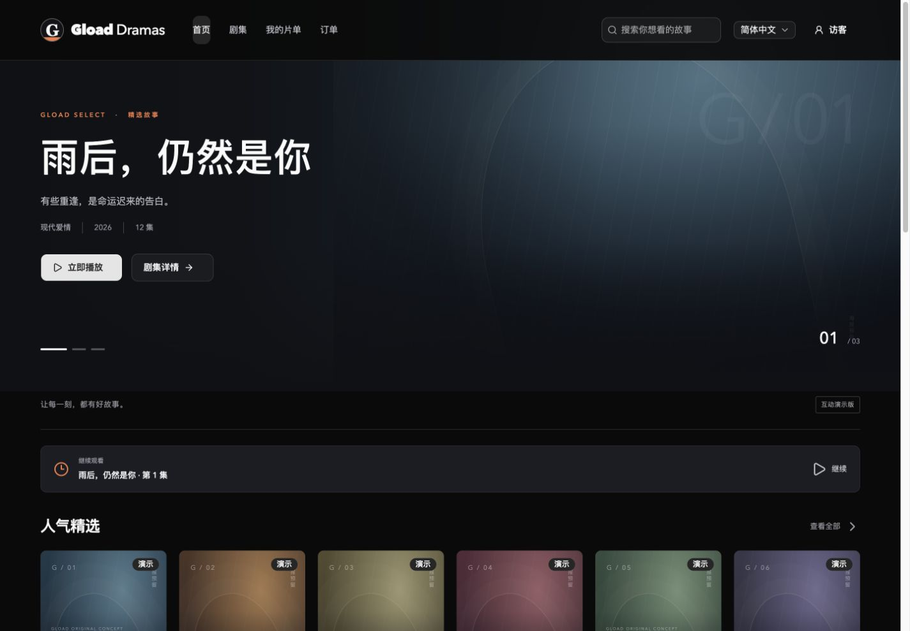

# GlobalDramas

**面向全球观众的短剧平台，包含 Gload Dramas Web/H5 前台、内容管理后台和 Go 业务服务。**

[在线体验](http://huanqiucs.com) · [本地开发](LOCAL-DOCKER.md) · [业务指南](docs/GLOBAL-DRAMAS-GUIDE.md) · [前台说明](web/README.md) · [后台说明](webAdmin/README.md)



## 项目组成

| 应用 | 技术栈 | 用途 |
| --- | --- | --- |
| Web / H5 | React、TypeScript、Vite、Tailwind CSS、shadcn/ui | 发现短剧、搜索、播放、选集与个人片单 |
| 管理后台 | Ant Design Pro、Umi Max、Ant Design 6 | 内容审核、运营配置、用户订单与财务管理 |
| 业务服务 | Go、Gin、GORM、JWT、Casbin | 后台业务接口、权限与观众接口基础 |
| 数据库 | PostgreSQL | 业务数据、审核记录与审计 |
| 开发与部署 | Docker Compose、Nginx | 本地运行与 Web 静态发布 |

## 观众体验

- **首页发现**：精选轮播、最新发布、热播榜单、推荐与题材栏目；桌面左右翻页，H5 横向滑动。
- **搜索与分类**：剧名搜索、类别与题材筛选，支持简体中文和英文。
- **播放与选集**：进入详情自动播放第一集，H5 竖向滑动切集，动态标记当前播放集。
- **片单与记录**：喜欢、收藏、分享、观看记录与进度恢复；收藏同步显示在个人中心。
- **响应式交互**：桌面卡片平滑悬停预览、紧凑手机页头与登录弹窗、亮暗主题切换。

## 管理后台

后台面向版权方/制片方与超级管理员，短剧业务包含内容与审核、策略、会员、用户、订单、广告记录、财务、数据分析、审批审计与异常恢复。系统管理包含角色、菜单、API、用户、字典、参数、Token、版本、日志与素材。

后台业务接口接入 Go 与 PostgreSQL，使用 JWT 和 Casbin 校验权限；菜单来自服务端授权菜单树。观众身份和业务服务与后台权限分离。

## 当前接入状态

| 范围 | 当前状态 |
| --- | --- |
| 观众前台 | 可交互的演示体验，使用导入的剧名、海报与集数 |
| 热播榜单、分类与简介 | 演示排序及编辑数据，尚未接入真实热度统计 |
| 视频播放 | 所有选集共用公开授权的 Sintel 预告样片 |
| 喜欢、收藏、观看进度与演示解锁 | 保存在当前浏览器，不同步到业务数据库 |
| TikTok 登录、支付、正式剧集媒资 | 尚未接入，演示交互不代表实际账号或购买权益 |
| 管理后台 | 使用真实业务接口与 PostgreSQL；外部渠道能力仍需要对应平台配置 |
| 公网演示 | 仅部署 Web 静态资源，当前使用 HTTP；未部署后台或数据库 |

前台演示数据与后台真实业务数据是两套独立来源。正式业务接入需完成观众认证、媒资、权益和支付联调。

## 本地启动

需要 Docker Desktop 与 Python 3。Go 和 Node.js 在容器内运行。

```sh
git clone https://github.com/dingmuran/GlobalDramas.git
cd GlobalDramas
python3 deploy/init-local-config.py
docker compose -f compose.local.yaml up -d
```

首次启动会下载镜像、安装依赖并编译服务。启动后，新环境执行：

```sh
python3 deploy/bootstrap-local-database.py
```

按提示设置管理员密码，初始化完成后使用 `admin` 登录。已有配置和数据库的环境直接启动 Docker，保留 `.env`、本地配置与数据卷，无需再次初始化。

| 服务 | 本地地址 |
| --- | --- |
| 观众 Web / H5 | http://localhost:8081 |
| 管理后台 | http://localhost:8080 |
| Go 服务 | http://localhost:8888 |
| PostgreSQL | `127.0.0.1:15432` |

配置、凭据、数据库和上传文件不提交 Git。容器内编辑与类型识别见 [Docker 开发指南](LOCAL-DOCKER.md)。

## 目录结构

```text
web/                 观众 Web / H5
webAdmin/            管理后台
server/              Go 业务服务
packages/contracts/  共享接口类型
deploy/             本地初始化脚本与 Nginx 配置
docs/               业务指南、数据字典与界面截图
aiDoc/              模块约束、接口边界与需求记录
```

## 构建与验证

```sh
# 观众前台
docker compose -f compose.local.yaml exec -T web npm run build

# 管理后台
docker compose -f compose.local.yaml exec -T webAdmin npm run typecheck
docker compose -f compose.local.yaml exec -T webAdmin npm run test
docker compose -f compose.local.yaml exec -T webAdmin npm run build

# PostgreSQL 业务集成测试（已初始化的本地开发环境）
docker compose -f compose.local.yaml exec -T -e GD_INTEGRATION=1 \
  -e GVA_CONFIG=/workspace/server/config.local.yaml server go test ./plugin/dramas/...

# 更新共享接口类型
python3 deploy/generate-contracts.py
```

业务集成测试使用事务回滚。验证与初始化均应在本地开发环境执行。

## Web 静态部署

`web` 构建产物位于 `web/dist`，可独立由 Nginx 托管。页面使用无 `#` 的路径路由，Nginx 需要将页面请求回退到 `index.html`，以支持 `/about`、`/drama/:id` 等路径直接访问与刷新。

- [HTTP 配置](deploy/huanqiucs.nginx.conf)
- [HTTPS 配置模板](deploy/huanqiucs.https.nginx.conf)（需先配置对应域名证书）

解压静态发布包后，目录权限设为 `755`、文件权限设为 `644`。前台静态发布不会自动部署后端、管理后台或数据库。

## 文档与许可

- [业务操作说明](docs/GLOBAL-DRAMAS-GUIDE.md)
- [中文表字段字典](docs/DRAMAS-DATABASE.md) · [数据库结构 SQL](docs/DRAMAS-SCHEMA.sql)
- [业务接口契约](aiDoc/frontend-backend/dramas-contract.md) · [观众接口边界](aiDoc/frontend-backend/viewer-api.md)

项目基于 [gin-vue-admin](https://github.com/flipped-aurora/gin-vue-admin) 二次开发，原许可证与源码声明保留，见 [LICENSE](LICENSE)、[NOTICE](NOTICE) 和 [原项目说明](README.upstream.md)。后台模板来源于 [Ant Design Pro](https://github.com/ant-design/ant-design-pro)，其 MIT 声明保留在 [模板许可证](webAdmin/LICENSE.ant-design-pro)。

Sintel 样片的来源、署名与 CC BY 3.0 许可见 [素材归属说明](web/public/media/ATTRIBUTION.md)。正式使用剧集与海报时需具备对应作品授权。
