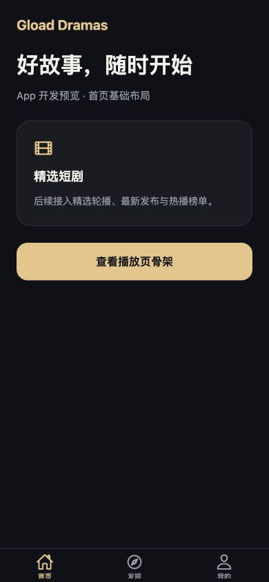

# Gload Dramas App 骨架

独立的 React Native + Expo + TypeScript 工程，使用 Expo Router。先保留可运行的页面与接口边界，后续开发 iOS / Android App 时在此继续。

## 当前范围

- 首页 / 发现 / 我的三个底部入口。
- `/drama/[id]` 播放页占位、返回导航和未找到页面。
- 深色基础主题、安全区、可访问触控按钮。
- Go 公开观众目录请求封装，复用 `@gload-dramas/contracts` 类型。
- 页面不发送网络请求；没有正式登录、真实视频、付费权益或本地收藏实现。



## 启动

Node.js 22.13+，使用 npm；在 `mobile/` 运行：

```sh
npm ci
npm start
```

使用兼容当前 Expo SDK 的 Expo Go 扫描二维码，或在已配置的模拟器运行：

```sh
npm run ios
npm run android
npm run web
```

浏览器预览仅辅助查看骨架，现有 `web/` 仍是独立观众网站。原生 SDK 或定制模块接入后，使用 development build。当前未绑定 EAS 项目、Apple/Google 开发者账号或正式 bundle/package ID，也未生成原生工程。

## 接口配置

复制 `.env.example` 为 `.env.local`，设置 `EXPO_PUBLIC_API_BASE_URL` 为 Go 服务根地址。

- iOS 模拟器：`http://localhost:8888`
- Android 模拟器：`http://10.0.2.2:8888`
- 真机：电脑局域网地址，例如 `http://192.168.1.100:8888`；电脑与手机处于同一网络。

现有公网网站仅托管静态 Web，不能当作已经部署的 Go API。正式接入时配置实际 API 域名并按移动平台网络策略使用 HTTPS。

`EXPO_PUBLIC_*` 会随 App 发布，不可存放密钥。接口封装只预留 `/viewer/v1` 公开目录，不复用后台登录和管理员 Token。目录选集返回元数据，没有视频地址；真正播放需要后续授权接口。

## 目录

```text
src/app/          文件路由与导航
src/components/   原生基础组件
src/config/       公开环境配置
src/services/     请求与公开观众接口
src/theme.ts      基础色彩
```

`packages/contracts` 通过本地 file 依赖共享，必须保留在仓库内相对位置。仅共享接口与纯业务逻辑，不引用 Web 的 DOM、CSS、shadcn 组件或浏览器存储。

## 验证

```sh
npm run typecheck
npm run lint
npm run doctor
npm run export:check
```

导出检查覆盖 iOS / Android / Web 的 JavaScript 打包，不等于原生安装包或上架验证。原生播放、滑动切集、登录、收藏同步、支付与推送在后续需求中开发。模板图标为占位资源，正式品牌图标随 App 设计替换。

配置参考 [Expo 官方文档](https://docs.expo.dev/get-started/create-a-project/) 与 [Expo Router](https://docs.expo.dev/router/introduction/)。

## 依赖检查记录

2026-10-10：Expo Doctor 21/21 通过；类型、Lint 与三端 JavaScript 导出检查通过。浏览器 390px 预览验证底部导航、播放入口与返回；未执行 iOS / Android 原生安装及真机验证。`npm audit fix` 已执行兼容范围更新，仍有 28 项上游依赖告警（10 moderate、18 high，包含传递依赖统计），涉及 Metro/构建工具及路由解码依赖；不使用会降级 Expo 或跨 SDK 升级的 `--force`。正式开发前需要跟随 SDK 兼容版本复核。
